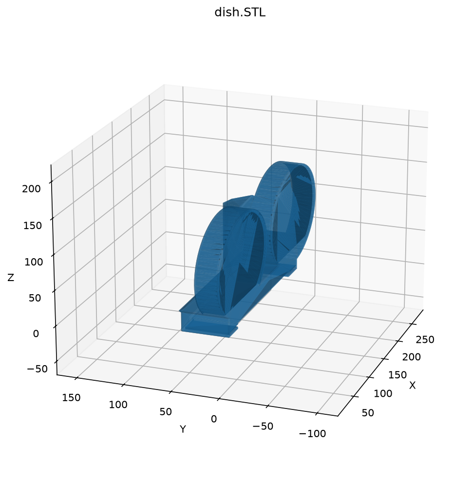
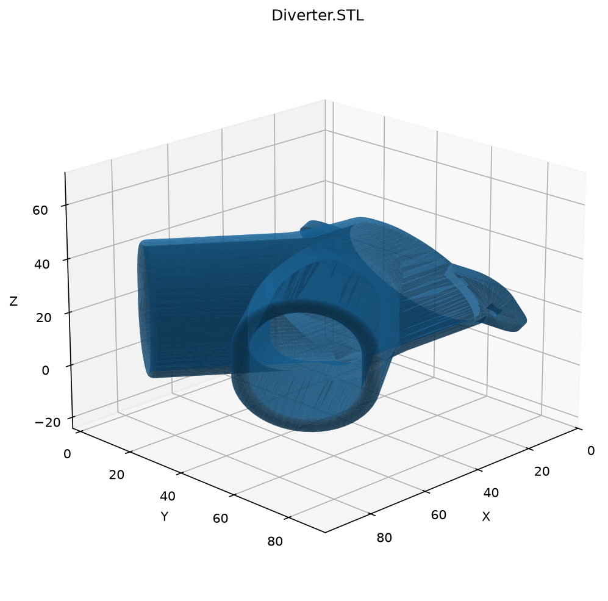

# Two cat feeder for PetFeedster

I had a PetFeedster and then I got two cats, so I 3d modeled a diverter to try to get equal food in a split tray for two cats. Worked well until the machine died.

## Models

### Dish

### Diverter

